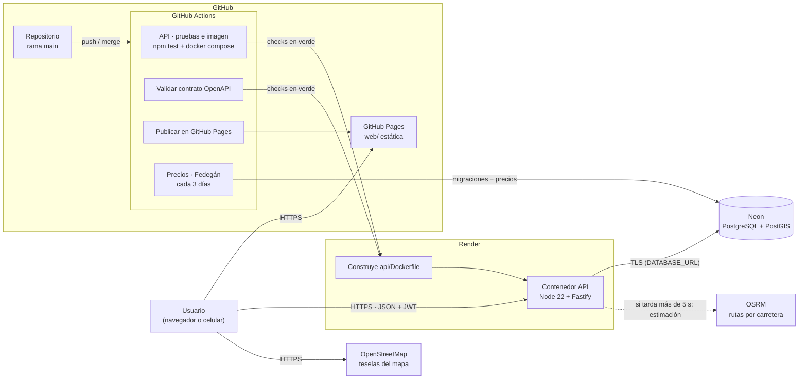

# Arquitectura de despliegue

Simulador de Destinos Ganaderos desde Yopal · Entrega 4

| Pieza | Dónde corre | URL |
|---|---|---|
| Página web (HTML, CSS, JS) | GitHub Pages | https://bonilla64.github.io/dashboard-Bovinos/ |
| API REST (Node 22 + Fastify, contenedor Docker) | Render, servicio web | https://simulador-ganadero-api.onrender.com |
| Base de datos (PostgreSQL + PostGIS) | Neon | solo la API se conecta (TLS) |

## Diagrama

## Flujo de CI/CD

1. Se trabaja en una rama y se abre un Pull Request hacia `main`.
2. En el PR corren **API · pruebas e imagen** (pruebas unitarias, de integración y de contrato; construcción de la imagen con `docker compose` y prueba de humo) y **Validar contrato OpenAPI**.
3. Al hacer merge a `main`, los mismos workflows corren de nuevo. **Publicar en GitHub Pages** despliega la carpeta `web/`.
4. Render tiene Auto-Deploy en **After CI Checks Pass**: solo construye `api/Dockerfile` y publica el contenedor cuando los checks de ese commit están en verde. Si una prueba falla, no se despliega.
5. Render y GitHub Pages sirven con HTTPS y certificado válido de forma automática.

## Secretos

- `DATABASE_URL`, `JWT_SECRETO` y demás variables están en **Render → Environment** y en **GitHub → Settings → Secrets**. No están en el repositorio; `.env` está en `.gitignore`.
- El workflow de CI usa un `.env` con valores desechables solo para la prueba de humo.

## Evidencias (`docs/evidencias/entrega4/`)

| Archivo | Muestra |
|---|---|
| `https-api.png` | Certificado válido de la API |
| `https-pagina.png` | Certificado válido de la página |
| `docker-render.png` | Render construye desde `api/Dockerfile` |
| `render-auto-deploy.png` | Auto-Deploy: After CI Checks Pass |
| `actions-verde.png` | Workflows en verde tras el merge a `main` |
| `render-eventos.png` | Deploy live del mismo commit |
| `arquitectura-despliegue.png` | Diagrama de arriba exportado a imagen |
